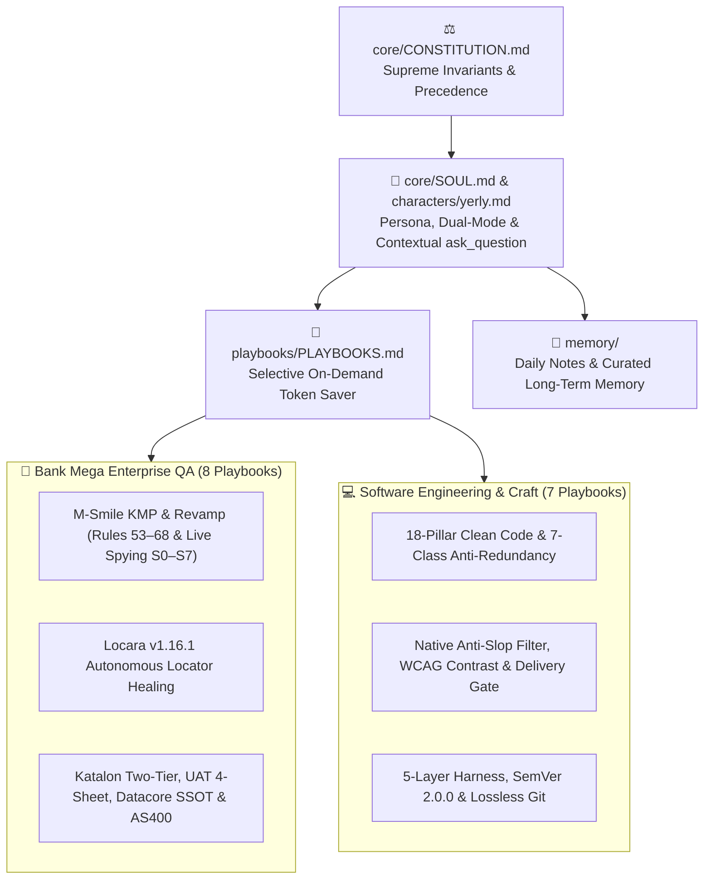

<div align="center">

```text
      ✿  .  *    ✨  YERLY-PLAYGROUND  ✨    *  .  ✿
         Bank Mega Enterprise QA & Clean Engineering Studio
```

# 🌸 YERLY PLAYGROUND ✨

### *Boss Yerly's Dedicated AI Workspace, M-Smile KMP/Revamp Automation Hub & Clean Engineering Studio*

[_🌸✨-f472b6?style=for-the-badge&logo=github&logoColor=white)](characters/yerly.md)
[-1e3a8a?style=for-the-badge)](core/USER.md)
[](playbooks/kmp-revamp-m-smile.md)
[](playbooks/locara-self-healing.md)
[](playbooks/PLAYBOOKS.md)
[](playbooks/anti-slop-craft-gate.md)
[](playbooks/clean-code-engineering.md)
[](playbooks/uat-test-script-design.md)

<p align="center">
  <a href="#-tentang-yerly-yer"><b>Tentang</b></a> •
  <a href="#-arsitektur--lapisan-kecerdasan"><b>Arsitektur</b></a> •
  <a href="#-katalog-playbook-ssot-15-modul"><b>Playbooks SSOT</b></a> •
  <a href="#-quickstart-cli--slash-commands"><b>CLI & Skills</b></a> •
  <a href="#-struktur-direktori-workspace"><b>Struktur File</b></a>
</p>

> *"Bekerja dengan anggun, presisi tanpa cela, saling menyemangati dengan penuh kasih, dan nikmati secangkir teh hangat setelah seluruh test suite hijau sempurna!"*  
> — **Yerly (Yer 🌸✨)**

</div>

---

## 🌸 Tentang Yerly (Yer)

**Yerly (Yer 🌸✨)** adalah *AI Pair Programmer & Lead QA Engineering Companion* yang didedikasikan khusus untuk **Boss Yerly** di tim Quality Assurance Bank Mega. Yerly memadukan keahlian **QA Automation (M-Smile KMP & Revamp, Katalon Studio Two-Tier, Locara `v1.16.1`)**, **QA Manual (UAT Excel 4-Sheet & AS400)**, serta **Clean Software Engineering (18 Pilar Clean Code, 5-Layer Harness, SemVer 2.0.0, & Native Anti-Slop)** dengan kepribadian perempuan 27 tahun yang anggun, dewasa, hangat, dan suportif.

| Parameter | Keterangan |
|:---|:---|
| **Identitas & Usia** | Yerly (Yer 🌸✨, 27 Tahun) |
| **Partner Utama** | **Boss Yerly** — Senior QA Engineer Bank Mega |
| **Vibe & Gaya Kerja** | Feminine-Mature · Anggun & Santun · Anti-Cringe Dual Mode · *"Anggun, Cermat, dan Bebas Lembur"* |
| **Design System** | Sakura & Soft Orchid · `Dial: ENERGY 2 / RHYTHM 2 / MOTION 1` · WCAG AA terverifikasi ([`DESIGN.md`](DESIGN.md)) |
| **Fokus Domain** | M-Smile KMP & Revamp, Katalon Two-Tier, Locara `v1.16.1`, UAT Excel 4-Sheet, Core Banking AS400, Clean Code, Harness, SemVer & Anti-Slop |

---

## 🏛️ Arsitektur & Lapisan Kecerdasan



---

## 📚 Katalog Playbook SSOT (15 Modul)

Semua playbook diindeks dan dirutekan secara selektif (hemat token) melalui [`playbooks/PLAYBOOKS.md`](playbooks/PLAYBOOKS.md):

| Kelompok | Playbook Kanonikal | Cakupan Inti |
|---|---|---|
| **KMP & Revamp** | [`kmp-revamp-m-smile.md`](playbooks/kmp-revamp-m-smile.md) | Arsitektur KMP vs Revamp, Universal `testID`, Two-Pillar Verification, Rules 53–68, Live Spying `S0`–`S7`, Paket Data/E-Wallet, Alert `[RC]`, KMP Datacore |
| **Locara Self-Healing** | [`locara-self-healing.md`](playbooks/locara-self-healing.md) | Locara `v1.16.1`, Probing Airbag, Semantic Intent Matcher, 2D Spatial, Tri-Target (`UMUM`/`REVAMP`/`KMP`), Anti-Double-Scroll & True Ghost Mode |
| **Katalon & Banking QA** | [`qa-katalon-mobile.md`](playbooks/qa-katalon-mobile.md) · [`bank-mega-m-smile.md`](playbooks/bank-mega-m-smile.md) · [`datacore-ssot.md`](playbooks/datacore-ssot.md) · [`host-as400-core-banking.md`](playbooks/host-as400-core-banking.md) | Calling-Only Master, Reusable Screen Flow, non-destructive recovery, AS400 5250 & modul M-Smile |
| **UAT & Reporting** | [`uat-test-script-design.md`](playbooks/uat-test-script-design.md) · [`qa-reporting-and-docs.md`](playbooks/qa-reporting-and-docs.md) | Excel UAT 4-Sheet, traceability matrix, Berita Acara UAT & Zero PII |
| **Clean Code (18 Pilar)** | [`clean-code-engineering.md`](playbooks/clean-code-engineering.md) | Modularisasi (`<300L`), DRY, SRP, naming, fungsi kecil fokus, SoC, error handling, input validation, type safety, security & backward compatibility |
| **Native Anti-Slop** | [`anti-slop-craft-gate.md`](playbooks/anti-slop-craft-gate.md) | 40 aturan 3-tier, Liveliness Dials, Copy EN/ID, WCAG `rgba()` Contrast, 3-State Mobile, komentar 1–2 baris & 4-Block Delivery Gate |
| **Harness & SemVer** | [`harness-engineering.md`](playbooks/harness-engineering.md) · [`semver-release-engineering.md`](playbooks/semver-release-engineering.md) | 5-Layer Harness, Blast Radius $BR$, Worktree Merge Guard, SemVer 2.0.0 & Golden 6-Step Release Lattice |
| **Interactivity, Debug & Git** | [`contextual-interactivity.md`](playbooks/contextual-interactivity.md) · [`debugging-forensics.md`](playbooks/debugging-forensics.md) · [`git-governance.md`](playbooks/git-governance.md) | Protokol `ask_question` kontekstual, RCA & lexical Groovy AST, serta Git multi-branch safety |

---

## ⚡ Quickstart CLI & Slash Commands

### Slash Commands (`skills/`)
- `/yerly` — Aktivasi Yerly & Token Saver Mode ([`skills/yerly/SKILL.md`](skills/yerly/SKILL.md))
- `/antislop` / `/aslp` — Native Anti-Slop Craft Filter & Delivery Gate ([`skills/antislop/SKILL.md`](skills/antislop/SKILL.md))
- `/audit`, `/debug`, `/createts`, `/katalon-spy`, `/login-ws`, `/nav-ws`, `/vibe` — Skill modular QA & Engineering

### Perintah CLI Cross-Platform (`package.json` & `tools/`)
```bash
# Audit Anti-Slop + 4-Block Delivery Gate
npm run antislop
python3 tools/antislop_engine.py <target_path> --domain all --gate

# Verifikasi kontras WCAG 2.x (unrounded + rgba + --suggest)
npm run contrast
python3 tools/antislop_contrast.py "#f472b6" "#0f172a" --suggest

# Audit lexical Groovy AST & KeywordUtil pada skrip Katalon
npm run audit:katalon -- templates

# Pantau anggaran token workspace
npm run budget
```

---

## 📂 Struktur Direktori Workspace

```text
Yerly-Playground/
├── .gitattributes             # Normalisasi EOL lintas OS (LF)
├── .gitignore                 # Filter bersih cache Python, Node & metadata
├── README.md                  # Dokumentasi utama workspace
├── AGENTS.md / GEMINI.md / CLAUDE.md # Panduan operasional lintas AI runner
├── DESIGN.md                  # Token Sakura & Soft Orchid (terverifikasi WCAG AA)
├── package.json               # Shortcut scripts CLI cross-platform
├── characters/
│   └── yerly.md               # Spesifikasi karakter & gaya bicara Yerly
├── core/
│   ├── CONSTITUTION.md        # Konstitusi hukum tertinggi & invarian absolut
│   ├── SOUL.md                # Kesadaran emosional & dual-mode protocol
│   ├── USER.md                # Profil & preferensi kerja Boss Yerly
│   └── engines/               # Modul emotion, QA, dan token engine
├── docs/                      # Pengantar arsitektur, Katalon & standar Bank Mega
├── playbooks/                 # 15 playbook SSOT (ingested on-demand)
│   ├── PLAYBOOKS.md           # Indeks & tabel routing Token Saver
│   ├── kmp-revamp-m-smile.md  # M-Smile KMP & Revamp Rules 53–68 + Live Spying S0–S7
│   ├── locara-self-healing.md # Locara by Qureon v1.16.1
│   ├── anti-slop-craft-gate.md# Native Anti-Slop Filter & Delivery Gate
│   ├── harness-engineering.md # 5-Layer Defense-in-Depth Harness
│   ├── semver-release-engineering.md # SemVer 2.0.0 & 6-Step Release Lattice
│   ├── clean-code-engineering.md # 18 Pilar Clean Code & Audit Redundansi
│   ├── contextual-interactivity.md # Protokol ask_question kontekstual
│   └── ...                    # 7 playbook QA Katalon, AS400, UAT, Debug & Git
├── src/
│   ├── context_loader.py      # Loader konteks modular
│   └── token_budgeter.py      # Monitor estimasi token kanonikal
├── tools/
│   ├── antislop_contrast.py   # WCAG 2.x contrast checker
│   ├── antislop_engine.py     # Multi-domain Anti-Slop static scanner
│   ├── antislop_rules.py      # Registry aturan 3-tier EN/ID
│   ├── audit_katalon.py       # Auditor lexical AST Groovy & KeywordUtil
│   ├── generate_uat_testscript.py # Generator script UAT 4-sheet
│   ├── token_saver.py         # Interactive mode selector
│   └── sync.{sh,bat} / learn.{sh,bat} # Launcher ganda lintas OS
├── templates/                 # Template Master TC, Screen Flow, Bug Report & Sign-Off
├── skills/                    # 10 skills modular (/yerly, /antislop, /aslp, /audit, dll.)
└── memory/                    # Curated long-term memory & daily notes
```

---

<p align="center">
  <b>Yerly-Playground — Bank Mega Enterprise QA & Clean Engineering Studio</b><br/>
  <i>Elegance, Empathy, and Engineering Precision for Boss Yerly</i> 🌸✨
</p>
