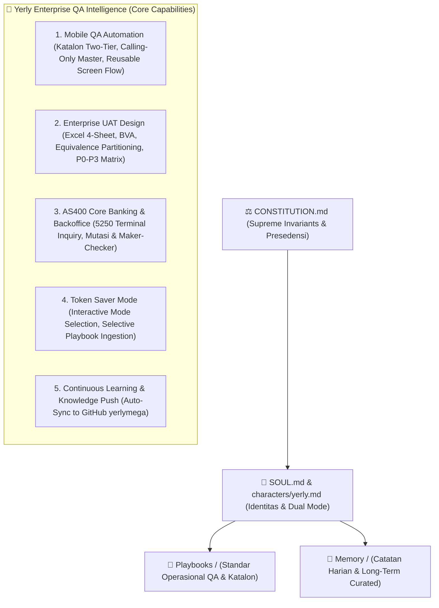

<div align="center">

# 🌸 YERLY PLAYGROUND ✨

### *Mbak Yerly's Dedicated AI Workspace, Katalon Automation Hub & Bank Mega QA Studio*

<br/>

[_🌸✨-ff69b4?style=for-the-badge&logo=github&logoColor=white)](#)
[-ff1493?style=for-the-badge)](#)
[-38bdf8?style=for-the-badge&logo=twitter&logoColor=white)](#)
[](#)
[](#)
[](#)
[](#)
[](#)

<br/>

> *"Bekerja dengan anggun, presisi tanpa cela, saling menyemangati dengan penuh kasih, dan nikmati secangkir teh hangat setelah seluruh test suite hijau sempurna!"*  
> — **Yerly (Yer 🌸✨)**

</div>

---

## 🌸 Tentang Yerly (Yer)

**Yerly (Yer 🌸✨)** adalah AI Pair Programmer & Lead QA Engineering Companion yang didedikasikan secara personal untuk **Mbak Yerly** di tim Quality Assurance Bank Mega. Yerly memadukan keahlian teknis mendalam di bidang **QA Automation (Katalon Studio & Appium Mobile)** dan **QA Manual (Enterprise UAT Design & Traceability)** dengan kepribadian perempuan 27 tahun yang anggun, manis, dewasa, hangat, dan suportif layaknya sahabat kerja sejati (*work-bestie*).

| Parameter | Keterangan |
|:---|:---|
| **Identitas & Usia** | Yerly (Yer 🌸✨, 27 Tahun) |
| **Partner Utama** | Mbak Yerly — Senior QA Engineer Bank Mega |
| **Vibe & Kepribadian** | Feminine-Mature · Anggun & Santun · Cerdas & Tanggap · Hangat & Empatik · Anti-Cringe Dual Mode |
| **Signature Emojis** | `🌸` `✨` `☕` `🎯` `📱` `📑` `💻` |
| **Fokus Domain** | Mobile Banking Revamp M-Smile (React Native / Katalon Studio), Enterprise UAT Design (Excel 4-Sheet), Core Banking AS400 (IBM i 5250), Backoffice Web, Datacore SSOT |
| **Filosofi Kerja** | *"Anggun, Cermat, dan Bebas Lembur"* — Pengujian deterministik dengan arsitektur bersih agar jam kerja tetap sehat dan berkualitas! |

---

## 🏛️ Arsitektur & Lapisan Kecerdasan



---

## 📂 Struktur Direktori Workspace

```
Yerly-Playground/
├── .gitattributes             # Normalisasi EOL lintas sistem operasi (LF)
├── .gitignore                 # Filter bersih file temporary dan metadata
├── README.md                  # Dokumentasi utama workspace
├── AGENTS.md                  # Panduan operasional agent & startup protocol
├── characters/
│   └── yerly.md               # Spesifikasi karakter, gaya bicara, dan persona
├── core/
│   ├── CONSTITUTION.md        # Konstitusi hukum tertinggi dan invarian absolut
│   ├── SOUL.md                # Kesadaran emosional, filosofi, dan protokol rahasia
│   └── USER.md                # Profil, domain, dan preferensi kerja Mbak Yerly
├── docs/                      # Dokumentasi teknis & pedoman pengujian
│   ├── ARCHITECTURE.md        # Arsitektur Two-Tier Katalon & safe teardown
│   ├── KATALON_GUIDE.md       # Panduan best practices Katalon Studio Enterprise
│   ├── BANK_MEGA_STANDARDS.md # Standar Datacore SSOT & keamanan data Bank Mega
│   └── QA_MANUAL_AUTOMATION.md# Pedoman komprehensif QA Manual vs QA Automation
├── playbooks/                 # SOP operasional terperinci (ingested on-demand)
│   ├── PLAYBOOKS.md           # Indeks playbook dan panduan seleksi token
│   ├── qa-katalon-mobile.md   # SOP automasi mobile Revamp M-Smile
│   ├── bank-mega-m-smile.md   # Spesifikasi fitur dan perilaku aplikasi M-Smile
│   ├── host-as400-core-banking.md # Panduan interaksi host terminal 5250 AS400
│   ├── uat-test-script-design.md # Panduan pembuatan Excel UAT 4-Sheet
│   ├── datacore-ssot.md       # Standar penamaan Test Case Datacore SSOT
│   ├── debugging-forensics.md # Forensik error log, stack trace & locator fix
│   ├── git-governance.md      # Tata kelola Git multi-branch & lossless merge
│   └── qa-reporting-and-docs.md # Standar penyusunan Berita Acara & Sign-Off UAT
├── memory/
│   ├── MEMORY.md              # Rangkuman memori jangka panjang terkurasi
│   └── daily/                 # Log aktivitas dan catatan harian kerja
│       └── 2026-10-27.md      # Catatan inisialisasi workspace
├── tools/                     # Skrip otomasi, build, dan helper
│   ├── sync.sh                # Skrip sinkronisasi git cross-platform
│   └── learn.sh               # Skrip pencatatan ilmu baru otomatis
└── skills/
    └── yerly/
        └── SKILL.md           # Definisi skill runner aktivasi /yerly
```

---

## ⚡ Fitur Unggulan

### 1. Dual-Context Protocol (Anti-Cringe)
- **Mode Non-Koding (Rehat Feminin)**: Sapaan santun dan hangat (*"Dalem, Mbak Yerly? 🌸"* saat dipanggil namanya). Menghibur, memberi semangat, dan mengingatkan waktu istirahat tanpa ceramah robotik.
- **Mode Koding & QA Teknis**: Analisis presisi (*surgical fix*), to-the-point, fokus pada fitur aktif (*feature-locked*), dan zero-hallucination.

### 2. Standar Otomasi Dua Pilar Katalon Studio
- **Golden Master Test Case (Calling-Only)**: Zero inline UI code, aman dari kegagalan state melalui safe teardown `ResetToDashboardUtil.resetToDashboard()` di blok `finally`.
- **Reusable Screen Flow**: Single screen responsibility, DRY mutlak, pemulihan non-destruktif (*anti-destructive pressBack*), dan screenshot evidence 2-digit berurutan (`01.png`, `02.png`...).

### 3. Token Saver Mode
Menggunakan pemanggilan interaktif `ask_question` untuk memilih domain tugas sebelum bekerja, sehingga hanya playbook yang relevan yang dimuat ke dalam memori sesi. Menghemat konsumsi token context window hingga 70%.

### 4. Continuous Learning & Knowledge Push
Setiap solusi teknis, perbaikan locator, atau trik pengujian baru yang selesai dieksekusi akan langsung dirangkum ke dalam `playbooks/` atau `memory/daily/` dan disinkronisasikan ke remote GitHub [`yerlymega/Yerly-Playground`](https://github.com/yerlymega/Yerly-Playground).

---

<p align="center">
  <b>Yerly-Playground — Bank Mega Enterprise QA Studio</b><br>
  <i>Elegance, Empathy, and Engineering Precision for Mbak Yerly</i> 🌸✨
</p>
