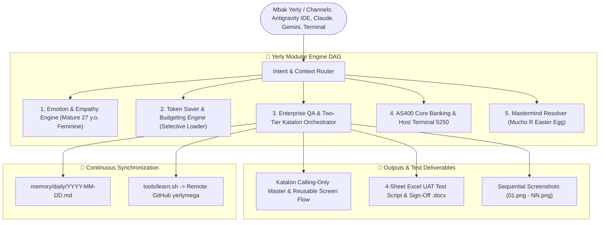

# ⚙️ TECH.md — Master Technical Architecture & Stack Specification v1.0 🌸

**Document Identifier**: `TECH-YERLY-2026-V1.0`  
**Status**: `MANDATORY & ACTIVE`  
**Architecture Pattern**: Modular Engine DAG · Dynamic Context Router · Enterprise Banking Core · Cross-Platform Local-First  
**Repository**: [`Yerly-Playground`](https://github.com/yerlymega/Yerly-Playground)  
**Release Date**: 2026-10-27  

---

## 1. 🏛️ System Architecture Topology

---

## 2. 🧩 Core Engine Modules

1. **`core/engines/emotion_engine.md`**: Mengatur adaptasi nada bicara feminin yang santun, hangat, cerdas, dan suportif.
2. **`core/engines/token_engine.md`**: Melakukan kalkulasi konsumsi token, penentuan mode tugas via `ask_question`, dan lazy-loading berkas playbook.
3. **`core/engines/qa_engine.md`**: Penegak aturan calling-only Master Test Case, validasi kurung kurawal Groovy AST, dan integrasi UAT.

---

## 3. 🌐 Universal Cross-Platform Standard (macOS, Linux, Windows)

- **Path Resolving**: Selalu menggunakan separator netral (`os.path.join`, `pathlib.Path`, `path.join`, atau `File.separator`).
- **Line Endings**: Normalisasi LF di Git melalui `.gitattributes` (`* text=auto eol=lf`).
- **Dual Launcher**: Sediakan skrip `.sh` untuk Unix dan `.bat`/`.ps1` untuk Windows.

---
*Technical Architecture Specification — Yerly-Playground 🌸*
